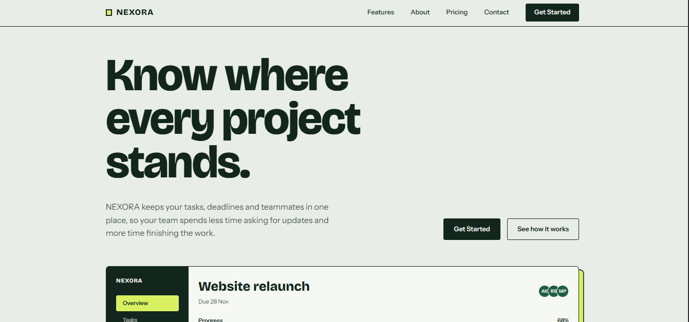
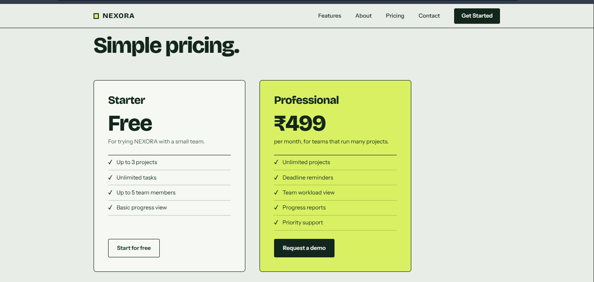
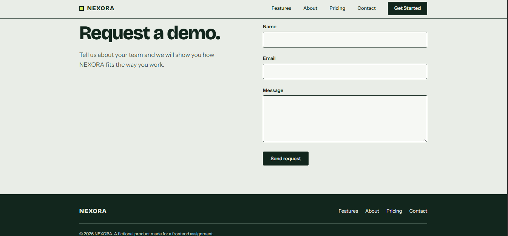
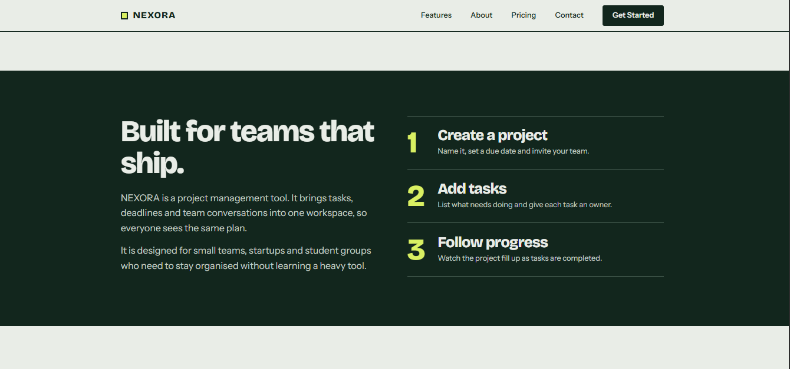

# NEXORA – SaaS Landing Page

A modern, responsive landing page for NEXORA, a fictional project management platform. Built as part of the Sankar Group Frontend Development Internship Assignment.

## Live Demo

[View NEXORA](https://nexora-amber-delta.vercel.app/)

## Screenshots

### Hero Section


### Pricing Section


### Contact Section


### About / How It Works


## Tech Stack

- React
- Vite
- JavaScript (ES6+)
- HTML / JSX
- CSS

## Features

- Responsive navigation with mobile menu
- Custom dashboard preview
- Features and How It Works sections
- Starter and Professional pricing plans
- Contact form with input validation
- Smooth scrolling and interactive elements
- Responsive desktop and mobile layouts

## Project Structure

```text
src/
├── components/
│   ├── Navbar/
│   ├── Hero/
│   ├── DashboardPreview/
│   ├── Features/
│   ├── About/
│   ├── Pricing/
│   ├── Contact/
│   └── Footer/
├── styles/
│   ├── variables.css
│   ├── global.css
│   └── responsive.css
├── App.jsx
└── main.jsx

screenshots/
├── hero.png
├── pricing.png
├── about.png
└── contact.png
```

Each component has its own CSS file to keep the code organized and maintainable.

## Getting Started

Clone the repository:

```bash
git clone https://github.com/Amaan11205/nexora.git
cd nexora
```

Install dependencies:

```bash
npm install
```

Start the development server:

```bash
npm run dev
```

Build for production:

```bash
npm run build
```

## Note

NEXORA is a frontend-only demonstration project. No backend, authentication or payment integration is included.
